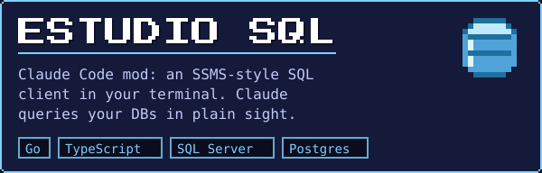
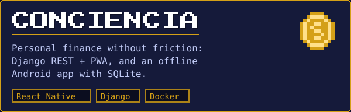
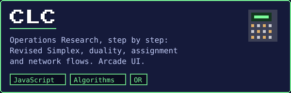
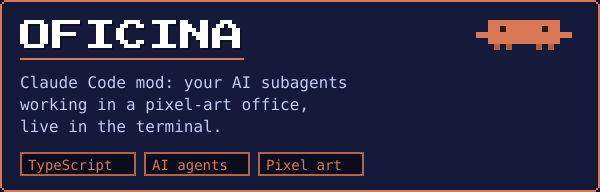
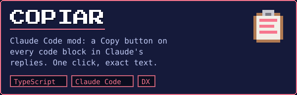
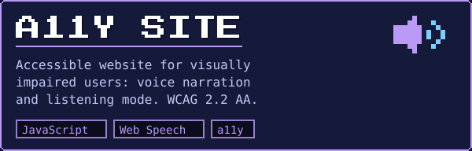
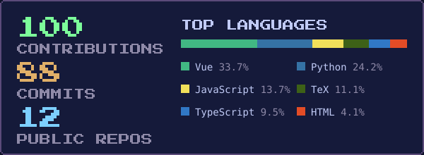

  

  

<b>English</b> · <a href="#es">Español</a>

## 👾 About me

- 🎓 **Software Engineering student** who likes shipping complete systems, not just exercises.
- 🛠️ I've built a **restaurant POS**, a **personal-finance app** (web + offline Android), **ERP integrations** and **desktop tools for lab data**.
- 🤖 Currently exploring **AI agents and developer tooling**: I build Claude Code mods, like a pixel-art office for subagents, a SQL client inside the terminal and one-click copy for code blocks.
- 🌱 I enjoy learning the unknown.

## 🧰 Tech stack

   
  

## 🚀 Featured projects

<table>
  <tr>
    <td width="50%"></td>
    <td width="50%"></td>
  </tr>
  <tr>
    <td width="50%"></td>
    <td width="50%"></td>
  </tr>
  <tr>
    <td width="50%"></td>
    <td width="50%"></td>
  </tr>
</table>

## 📊 Activity

  

  

---

<b>🇨🇴 Sobre mí — versión en español</b>

- 🎓 **Estudiante de Ingeniería de Software** al que le gusta terminar sistemas completos, no solo ejercicios.
- 🛠️ He construido un **POS para restaurantes**, una **app de finanzas personales** (web y Android sin conexión), **integraciones con ERP** y **herramientas de escritorio para datos de laboratorio**.
- 🤖 Ahora exploro **agentes de IA y herramientas para desarrolladores**: hago mods de Claude Code, como una oficina en pixel art para los subagentes, un cliente SQL dentro de la terminal y un botón para copiar los bloques de código.
- 🌱 Me gusta aprender lo desconocido.

**Proyectos destacados:** [Estudio SQL](https://github.com/waldooCreator/claude-code-estudio-sql) (cliente SQL en la terminal, mod de Claude Code) · [Conciencia Financiera](https://github.com/waldooCreator/Conciencia_financiera) (finanzas personales) · [CLC](https://github.com/waldooCreator/CLC) (Investigación de Operaciones paso a paso) · [Oficina](https://github.com/waldooCreator/claude-code-oficina) (mod de Claude Code) · [Copiar](https://github.com/waldooCreator/claude-code-copiar) (botón Copiar en los bloques de código, mod de Claude Code) · [Sitio accesible](https://github.com/waldooCreator/Previo-final-accesibilidad) (para personas con discapacidad visual).

Pixel art drawn in code: the banner, cards and stats are generated by the scripts in <a href="scripts">scripts/</a>; the stats refresh daily with GitHub Actions.

